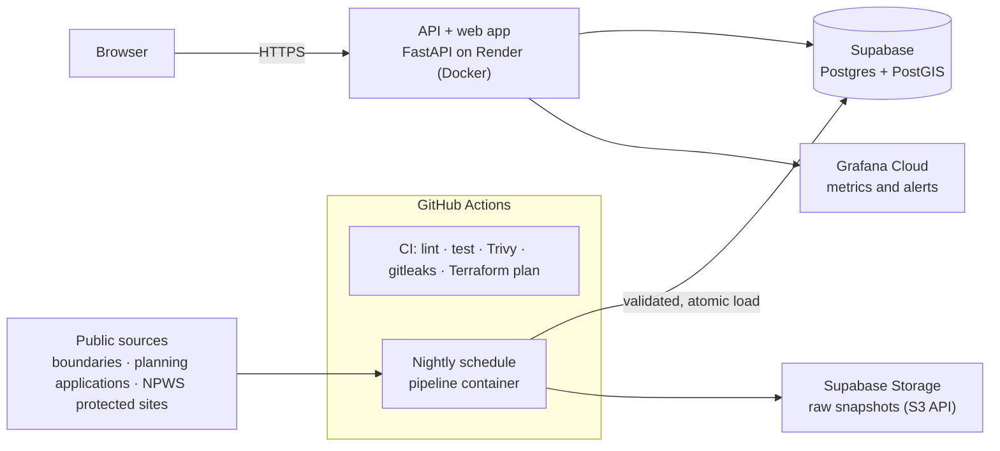

# DwellWise

[](https://github.com/Neel09apr/DwellWise/actions/workflows/ci.yml)
[](https://scorecard.dev/viewer/?uri=github.com/Neel09apr/DwellWise)
[](https://github.com/Neel09apr/DwellWise/actions/workflows/uptime.yml)
[](https://github.com/Neel09apr/DwellWise/issues?q=label%3Aincident)


A web app that turns public data into a pre-planning brief for small housing
schemes in Ireland, built and operated like a production service: infrastructure
as code, keyless and scanned delivery, a tested data pipeline, and
monitoring with alerts and runbooks.

Everything runs on free tiers, with no cloud account that can bill.

## Architecture



## What is in place

| Area | What | Why it matters |
|---|---|---|
| API | FastAPI `/v1` counties and settlements, `/health`, `/ready` (database and data freshness), Prometheus `/metrics`, one error envelope, security headers | Probes and dashboards have something real to watch |
| Web | React + TypeScript, hierarchical: Ireland > county > settlement, types generated from the OpenAPI spec | The API contract is checked at build time |
| Pipeline | Paged fetch, raw copy with SHA-256, validation (row floor, ±20% drift, required fields, geometry, no personal data), staged load swapped in one transaction | A bad source never replaces good data |
| Container | Multi-stage image, non-root user, health check; CI builds and smoke-tests it | What runs on Render is what CI tested |
| Scanning | Trivy (IaC and Dockerfiles, HIGH/CRITICAL fail), gitleaks over full history, findings in the Security tab | Problems are caught before merge |
| Delivery | Terraform plan on pull request, apply after a required approval, weekly drift check; the repository's own settings and `main` ruleset are Terraform too, applied with a one-hour GitHub App token | Every infrastructure change is reviewed as a plan; nothing reaches main without passing CI |
| Monitoring | Grafana Synthetic Monitoring probes `/health` and `/ready` from two locations; SLOs over 14 days with an error budget, multiwindow burn-rate alerts and a probe heartbeat; scrape, dashboard and alerts all Terraform; runbooks; blameless incident write-ups | Outages are measured against a stated objective and handled the same way every time |
| Kubernetes | Helm chart: non-root, read-only root filesystem, no capabilities, seccomp, limits, NetworkPolicy, no service-account token; every pull request installs it on a throwaway kind cluster that enforces Pod Security `restricted` and runs `helm test` | The same image is ready for a cluster, checked against the strictest built-in pod policy |
| Supply chain | Both images scanned by Trivy, pushed to GHCR, signed keyless with cosign and given an attested SPDX SBOM; the nightly pipeline runs only a digest whose signature it has verified; OpenSSF Scorecard weekly; Actions pinned to commit SHAs; provider checksums locked; Dependabot | A tampered or unscanned image never receives database credentials |

## AWS modules (tested against an emulator, not deployed)

`terraform/` holds AWS modules written to production standards: GitHub OIDC
with a read-only plan role and an apply role limited to `dwellwise-*`
resources behind a permissions boundary, an encrypted and versioned S3 state
bucket with native locking, a reusable `secure-bucket` module, and a $1 budget
alarm. No AWS account is used, so they are not deployed. Instead, every pull
request applies them to the [Floci](https://github.com/floci-io/floci) AWS
emulator: the bootstrap, then the data stack with its state in the bootstrap's
bucket (S3-native locking). A second plan must show no changes, and a script
checks the result: versioning, public access blocked, encryption, HTTPS-only
policy, and CI roles that trust exact GitHub subjects only. They are tested,
not only linted.

## Cost

| Service | Use | Monthly cost |
|---|---|---|
| Render | API and web container | $0 (free web service) |
| Supabase | Postgres + PostGIS, Storage for raw files | $0 (free) |
| GitHub Actions | CI and the nightly pipeline on a public repo | $0 |
| Grafana Cloud | Metrics and alerts | $0 (free tier) |
| Trivy, gitleaks, TFLint | Scanning and linting | Open source |
| **Total** | | **$0.00** |

## Repository layout

```
app/api/                  FastAPI: /v1, health, readiness, metrics; serves the web app
app/web/                  React + TypeScript web app
app/Dockerfile            one image for API and web
pipeline/                 nightly ingestion: fetch, raw copy, validate, load
terraform/                stacks/observability (Grafana), stacks/github (repo settings), stacks/supabase (security settings); AWS modules (emulator-tested)
docs/DESIGN.md            system design: requirements, architecture, SLOs, decisions
render.yaml               Render blueprint (free plan, Frankfurt)
deploy/helm/dwellwise/    Helm chart, installed on a throwaway kind cluster in CI
.github/workflows/
  ci.yml                  lint, test (PostGIS), build, scan
  terraform.yml           plan on PR, apply on approval, weekly drift check
  images.yml              build and scan images; on main push to GHCR, sign, attest SBOM
  pipeline.yml            nightly pipeline: verify the signed image, then run it
  scorecard.yml           OpenSSF Scorecard, weekly and on merge
  github-settings.yml     repository settings as Terraform: plan on PR and weekly, apply on merge
  supabase-settings.yml   Supabase security settings as Terraform, same pattern
SECURITY.md               reporting and security controls
```

## Roadmap

- [x] Keyless CI, scanning, AWS modules (not deployed)
- [x] Plan on pull request, apply on approval, weekly drift detection
- [x] Pipeline core with counties and settlements, tested against PostGIS
- [x] API and web app (first slice): settlement search and pages, one container, Render blueprint
- [x] Deploy to Render: https://dwellwise.onrender.com
- [x] Planning applications since 2020 and the national planning dashboard
- [x] Nightly pipeline on GitHub Actions, gzipped raw copies in Supabase Storage, 7-day retention
- [x] Settlement brief, first section: planning precedents
- [x] Protected sites (SAC, SPA, NHA) within 5 km: brief section 03
- [x] Brief section 01: link to the county's wastewater capacity register (its terms do not allow copying it)
- [ ] Nearby alternatives (section 04): needs capacity data that may not be republished
- [x] GitHub settings as Terraform: `main` ruleset, Dependabot alerts, secret scanning
- [x] AWS modules applied to the Floci emulator in CI on every pull request
- [x] Supabase security settings as Terraform (SSL enforcement); Terraform state connections require TLS
- [ ] Render as Terraform: blocked upstream (the provider cannot update free services); the Blueprint stays
- [x] Uptime probe with incidents opened and closed as GitHub issues (now a backup: GitHub's cron proved unreliable); runbooks
- [x] Grafana Cloud dashboard and alerts as Terraform, state in Postgres, applied by CI
- [x] Error tracking: unhandled API errors to Sentry, tagged with the deployed commit, no secrets in events
- [x] SRE practice: SLOs on synthetic checks, error budget and burn-rate alerts ([docs/slo.md](docs/slo.md)), incident write-ups ([docs/incidents/](docs/incidents/))
- [x] Supply chain: SBOM, signed container images, OpenSSF Scorecard
- [x] Kubernetes: Helm chart installed on a throwaway kind cluster in CI under Pod Security `restricted`, with `helm test`

## Licence

MIT. See [LICENSE](LICENSE).
