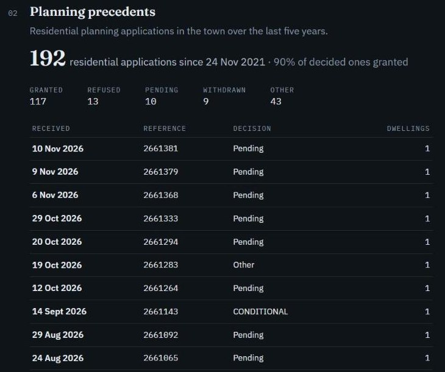
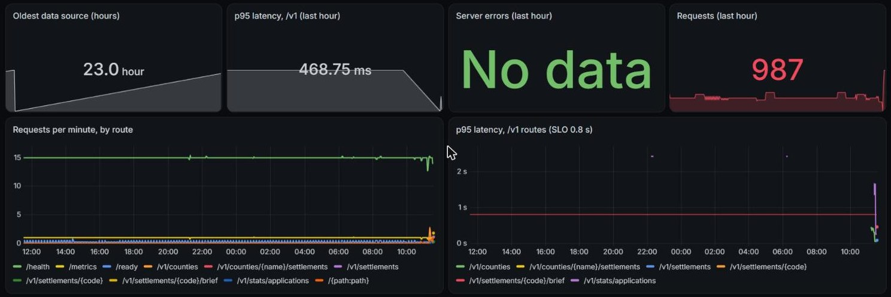
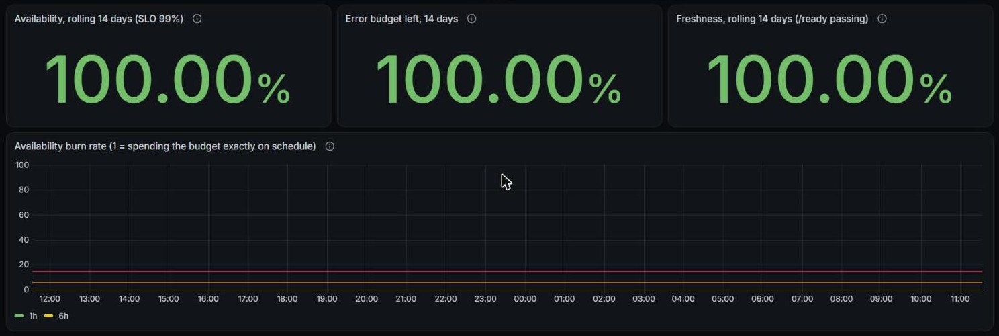
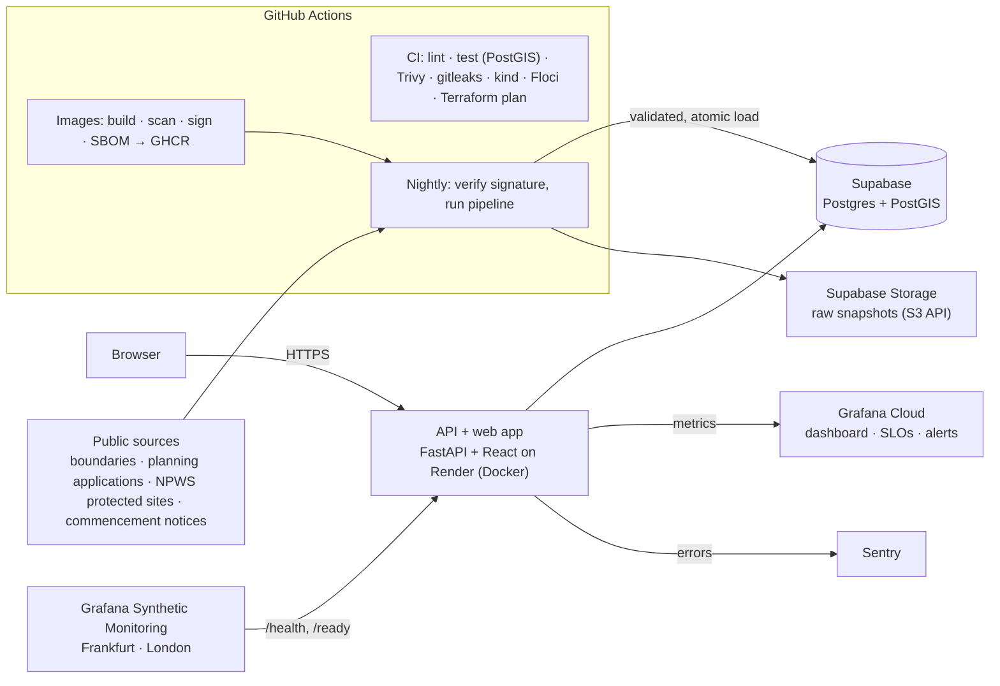

# DwellWise

[](https://github.com/Neel09apr/DwellWise/actions/workflows/ci.yml)
[](https://scorecard.dev/viewer/?uri=github.com/Neel09apr/DwellWise)
[](https://github.com/Neel09apr/DwellWise/issues?q=label%3Aincident)


**A small public web app, built and operated the way a production service should be.**
Live at **https://dwellwise.onrender.com**.

DwellWise turns Irish public data into a pre-planning brief for any town or
village: planning precedents, protected sites nearby, and a link to its
wastewater capacity. The product is small on purpose. The point of the
repository is everything around it: infrastructure as code, keyless and signed
delivery, a data pipeline that refuses bad data, service-level objectives with
an error budget, and honest write-ups of what went wrong. Everything runs on
free tiers for $0 a month.



## What it demonstrates

| Skill | Evidence in this repository |
|---|---|
| **Infrastructure as code** | Three Terraform stacks applied by CI, with state in Postgres over TLS: [Grafana Cloud](terraform/stacks/observability) (scrape job, dashboard, alerts, synthetic checks), [GitHub](terraform/stacks/github) (repository settings, `main` ruleset with 7 required checks, environments) and [Supabase](terraform/stacks/supabase) (SSL enforcement). Existing resources adopted with `import` blocks; weekly plans catch click-ops drift. |
| **Secure delivery** | No long-lived cloud keys. Terraform runs on a one-hour GitHub App token: read-only to plan, write only to apply on `main`. Actions are pinned to commit SHAs, provider checksums locked, gitleaks scans the full history, and push protection is on. |
| **Supply chain** | Both images are scanned by Trivy, pushed to GHCR by digest, signed keyless with cosign (Sigstore) and given an attested SPDX SBOM. The nightly pipeline runs only an image whose signature it has [verified](.github/workflows/pipeline.yml) came from this repository's `main`. OpenSSF Scorecard runs weekly. |
| **SRE and observability** | [SLOs](docs/slo.md) on Grafana Synthetic Monitoring: 99.0% availability and freshness over 14 days, an error budget, multiwindow burn-rate alerts and a heartbeat for the probes themselves. Prometheus metrics, a Terraform-managed dashboard, [runbooks](docs/runbooks/) linked from every alert, and unhandled errors in Sentry tagged with the deployed commit. |
| **Incident practice** | Blameless [write-ups](docs/incidents/) of real failures, each with a timeline, causes in the system and the process, and actions tracked to pull requests. |
| **Data reliability** | A nightly pipeline that fetches, keeps a hashed raw copy, validates (row floors, ±20% drift, geometry, required fields, no personal data) and swaps the data in within one transaction. A bad source never replaces good data. |
| **Containers and Kubernetes** | Non-root multi-stage images. A [Helm chart](deploy/helm/dwellwise) with a read-only root filesystem, no capabilities, seccomp, a NetworkPolicy and no service-account token. Every pull request installs it on a throwaway kind cluster that enforces Pod Security `restricted` and runs `helm test`. |
| **Cloud (AWS), tested without an account** | AWS modules (GitHub OIDC roles under a permissions boundary, an encrypted versioned state bucket, a budget alarm) applied on every pull request to the [Floci](https://github.com/floci-io/floci) emulator, then checked by a script. |

## What went wrong, and what changed

The two most useful documents here are the incident write-ups:

- **[The uptime probe never ran on its schedule.](docs/incidents/2026-11-21-uptime-probe-never-scheduled.md)**
  A GitHub Actions cron job meant to probe the site every 10 minutes ran once,
  by hand, and never again. The README already said "probed every 10 minutes".
  Measurement moved to Grafana's probes, with an alert for when *they* stop.
- **[SSL enforcement locked Terraform out of its own state.](docs/incidents/2026-11-21-ssl-enforcement-broke-terraform-state.md)**
  Enforcing TLS on the database worked, but Terraform kept its state in that
  database and connected without TLS. Fixed in seven minutes; the lesson is to
  test every client against a requirement before enforcing it.

Both lessons became rules for the project: a scheduled job is "running" only
after a scheduled run is seen, and a requirement is "enforced" only after every
client has been tested against it.

## Monitoring

The service dashboard and the SLO panels, both defined in Terraform
([`dashboard.json.tftpl`](terraform/stacks/observability)):




## Architecture



The design, requirements and decisions are in [`docs/DESIGN.md`](docs/DESIGN.md).

## Check it yourself

```bash
# Health, and readiness (database reachable, every source under 48 hours old)
curl -s https://dwellwise.onrender.com/health
curl -s https://dwellwise.onrender.com/ready

# The pipeline image is signed by this repository's images workflow on main
cosign verify ghcr.io/neel09apr/dwellwise-pipeline:latest \
  --certificate-identity https://github.com/Neel09apr/DwellWise/.github/workflows/images.yml@refs/heads/main \
  --certificate-oidc-issuer https://token.actions.githubusercontent.com
```

## Trade-offs, stated up front

- **$0 a month means free tiers, and their limits.** Render's free service is one
  instance with no zero-downtime deploys, so the availability objective is 99.0%,
  not 99.9%. Grafana's free tier keeps 14 days of metrics, so the SLO window is 14
  days.
- **No AWS account.** It is kept for another project, so the AWS modules are
  tested against an emulator and never called "deployed".
- **Render is not Terraform yet.** Its provider cannot update free services, so
  the [Blueprint](render.yaml) stays until it can, and Render builds the app from
  source rather than running the signed image.
- **One owner.** Terraform applies on merge; the review is the pull request and
  its plan, with no separate approval step.
- **Licences decide what is shown.** Uisce Éireann's capacity registers may not be
  republished, so the brief links to them instead of copying them, and the
  "nearby alternatives" section waits. Flood data is out: its licence forbids it.

## Cost

| Service | Use | Monthly cost |
|---|---|---|
| Render | API and web container | $0 (free web service) |
| Supabase | Postgres + PostGIS, Storage for raw files, Terraform state | $0 (free) |
| GitHub Actions and GHCR | CI, nightly pipeline, images (public repository) | $0 |
| Grafana Cloud | Metrics, dashboard, alerts, synthetic checks | $0 (free tier) |
| Sentry | Error tracking | $0 (free tier) |
| Trivy, gitleaks, TFLint, cosign, kind, Floci | Scanning, signing, testing | Open source |
| **Total** | | **$0.00** |

## Repository layout

```
app/api/                  FastAPI: /v1, /health, /ready, /metrics; serves the web app
app/web/                  React + TypeScript; types generated from the OpenAPI spec
pipeline/                 nightly ingestion: fetch, raw copy, validate, atomic load, prune
terraform/stacks/         observability (Grafana), github (repository), supabase (security), data (AWS, emulator)
terraform/bootstrap/      AWS OIDC roles and state bucket, tested against Floci
terraform/modules/        secure-bucket, the reusable AWS S3 module
deploy/helm/dwellwise/    Helm chart, installed on a throwaway kind cluster in CI
docs/                     DESIGN.md, slo.md, runbooks/, incidents/
ops/                      backup uptime probe; database URL helper for Terraform
render.yaml               Render Blueprint (free plan, Frankfurt)
.github/workflows/
  ci.yml                  lint, test (PostGIS), build, scan, kind, Floci
  images.yml              build and scan images; on main: push, sign, attest SBOM
  pipeline.yml            nightly: verify the signed image, then run it
  observability.yml       Grafana stack: plan on PR, apply on merge
  github-settings.yml     repository settings: plan on PR and weekly, apply on merge
  supabase-settings.yml   Supabase settings: plan on PR and weekly, apply on merge
  terraform.yml           AWS stack: plan and apply pipeline, idle without an AWS account
  scorecard.yml           OpenSSF Scorecard
  uptime.yml              backup probe that opens and closes incident issues
```

## Run the checks locally

```bash
cd pipeline && ruff check . && pytest -q && cd ..
cd app/api && ruff check . && pytest -q && cd ../..
cd app/web && npm ci && npm run typecheck && npm test && npm run build && cd ../..
terraform fmt -check -recursive terraform
```

Database tests need `DATABASE_URL` pointing at PostGIS; CI runs them against a
PostGIS service container.

## Licence

Code: MIT, see [LICENSE](LICENSE). Data, credited in each brief: boundaries
© Tailte Éireann; planning applications and protected sites from the Department
of Housing, Local Government and Heritage and the National Parks and Wildlife
Service; commencement notices from the National Building Control Office; all
CC BY 4.0.
