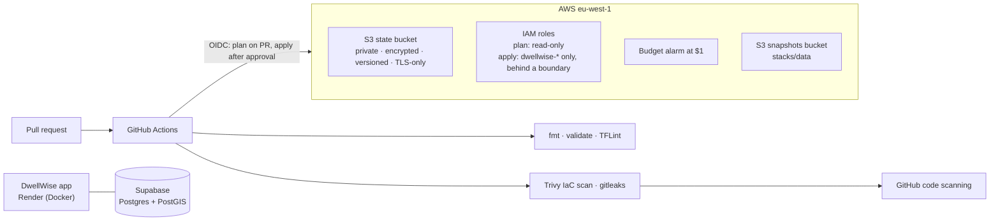

# DwellWise

[](https://github.com/Neel09apr/DwellWise/actions/workflows/ci.yml)


Infrastructure, delivery and operations for **DwellWise**, a web app that turns
a housing proposal in Ireland into a pre-planning brief backed by public
evidence. The application code lives in its own repository; this one is the
platform it runs on: cloud infrastructure as code, a keyless and scanned CI/CD
pipeline, and (coming next) monitoring with service-level objectives.

Everything here runs on free tiers. A budget alarm proves it.

## Architecture



## What is in place

| Area | What | Why it matters |
|---|---|---|
| Identity | GitHub OIDC provider and two IAM roles | No AWS access keys anywhere, so none can leak |
| Least privilege | Read-only plan role; apply role limited to `dwellwise-*` resources and to the approved `production` environment | A compromised pull request cannot change infrastructure |
| Privilege-escalation guard | Every role CI creates must carry a permissions boundary that CI cannot edit | CI can never mint a role stronger than the boundary |
| State | S3 backend with S3-native locking (Terraform 1.10+), versioned for rollback | No DynamoDB table to pay for or manage |
| Storage defaults | Reusable `secure-bucket` module: private, owner-enforced, encrypted, versioned, HTTPS-only, old versions expire | One reviewed pattern instead of hand-rolled buckets |
| Cost | Monthly budget with alerts at 50%, 100% and forecast 100% of $1 | Free-tier drift is caught in days, not on the invoice |
| Pipeline | Format, validate and lint every module; Trivy misconfiguration scan (HIGH/CRITICAL fail); gitleaks over full history | Problems are caught before merge, findings land in the Security tab |
| Delivery | Pull requests plan with the read-only role; merges apply with the production role after a required approval; a weekly plan fails on drift | Every change is reviewed as a plan, and out-of-band edits are caught |
| Supply chain | Actions pinned to commit SHAs; provider checksums locked; Dependabot for both | Tag hijacking cannot change what CI runs |

## Cost

| Service | Use | Monthly cost |
|---|---|---|
| AWS S3 | Terraform state (kilobytes) | $0.00 |
| AWS IAM, OIDC, STS | Roles and federation | Free |
| AWS Budgets | One budget | Free (first two) |
| GitHub Actions | CI on a public repo | Free |
| Trivy, gitleaks, TFLint | Scanning and linting | Open source |
| **Total** | | **$0.00**, alarmed at $1 |

**About the AWS free plan.** New accounts get up to $200 of credits on a free
plan that never bills, but it closes after six months unless upgraded to
pay-as-you-go. Everything here is Terraform, so the platform can be rebuilt on
a fresh account in minutes, and after an upgrade the budget alarm keeps any
drift visible. Things that silently trigger an upgrade (AWS Organizations,
Control Tower) are avoided by design.

## Design decisions

- **SSE-S3 instead of a customer-managed KMS key.** A KMS key costs about
  $1/month. The trade-off is recorded next to the code as a scanner
  suppression with its reason, not silently ignored.
- **Exact OIDC subjects, no wildcards.** The trust policies name the pull
  request context, `main`, and the `production` environment. A fork or
  another branch is refused.
- **Bootstrap applied by a human once.** The state bucket and CI roles cannot
  be created by the CI that depends on them. Everything after bootstrap goes
  through pull requests.
- **eu-west-1 (Ireland).** Next to the application database and its users.

## Repository layout

```
terraform/
  bootstrap/              state bucket, CI roles, permissions boundary, budget
  stacks/data/            workload storage, changed only through CI
  modules/secure-bucket/  the one S3 pattern every bucket uses
app/api/                  FastAPI: health, readiness, metrics, settlement search; serves the web app
app/web/                  React + TypeScript web app
pipeline/                 nightly ingestion: fetch, raw copy, validate, load (Lambda image)
docs/DESIGN.md            system design: requirements, architecture, SLOs, decisions
.github/workflows/
  ci.yml                  validate, lint, test, scan
  terraform.yml           plan on PR, apply on approval, weekly drift check
SECURITY.md               reporting and security controls
```

## Bootstrap (once per AWS account)

Prerequisites: an AWS account, Terraform 1.10 or later, and AWS CLI 2.32 or
later signed in as an administrator with `aws login`. That uses your console
sign-in (an IAM user with MFA, never the root user) and hands the CLI
short-lived credentials, so no access keys are created. IAM Identity Center is
deliberately not used: it needs AWS Organizations, and joining Organizations
upgrades a free-plan account to a paid one.

```bash
cd terraform/bootstrap
cp terraform.tfvars.example terraform.tfvars    # set alert_email
terraform init
terraform apply

# Move the state into the bucket it just created
cp backend.tf.example backend.tf
cp backend.hcl.example backend.hcl              # set bucket from the state_bucket output
terraform init -migrate-state -backend-config=backend.hcl
```

Then give CI what it needs. These values are identifiers, not secrets:

```bash
gh variable set AWS_REGION         --body "$(terraform output -raw aws_region)"
gh variable set TF_STATE_BUCKET    --body "$(terraform output -raw state_bucket)"
gh variable set AWS_PLAN_ROLE_ARN  --body "$(terraform output -raw plan_role_arn)"
gh variable set AWS_APPLY_ROLE_ARN --body "$(terraform output -raw apply_role_arn)"
```

Finally, create a `production` environment under **Settings → Environments**
with yourself as a required reviewer. The apply role only trusts that
environment.

## Roadmap

- [x] AWS baseline: keyless CI identity, state, cost guardrail, scanned pipeline
- [x] Plan on pull request, apply on approval, weekly drift detection
- [x] Pipeline core with counties and settlements: raw copies, validation, atomic loads, tested against PostGIS
- [x] API and web app (first slice): settlement search and pages, one container, Render blueprint
- [ ] Pipeline on AWS Lambda and EventBridge Scheduler; capacity registers, planning applications, protected sites
- [ ] Monitoring: uptime checks and public status page, metrics and dashboards, error tracking
- [ ] SRE practice: service-level objectives, alerts, runbooks, incident write-ups
- [ ] Supply chain: SBOM, signed container images, OpenSSF Scorecard
- [ ] Kubernetes: Helm chart deployed to a throwaway cluster in CI

## Licence

MIT. See [LICENSE](LICENSE).
