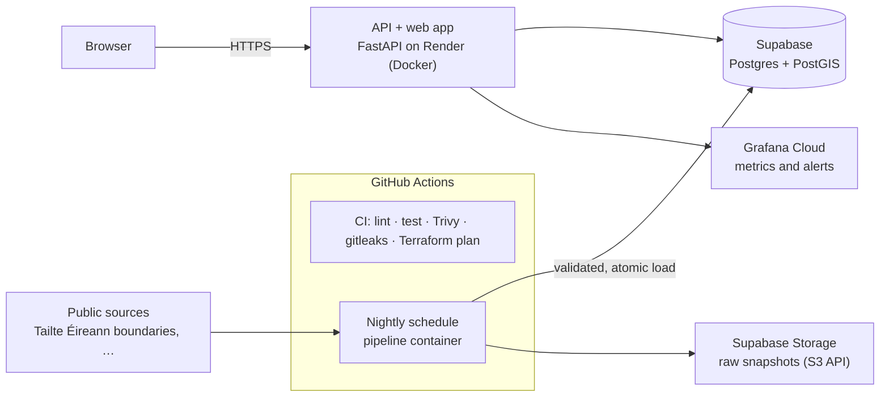

# DwellWise

[](https://github.com/Neel09apr/DwellWise/actions/workflows/ci.yml)


A web app that turns public data into a pre-planning brief for small housing
schemes in Ireland, built and operated like a production service: infrastructure
as code, keyless and scanned delivery, a tested data pipeline, and (coming next)
monitoring with service-level objectives.

Everything runs on free tiers, with no cloud account that can bill.

## Architecture



The nightly schedule, Storage copies and Grafana Cloud are wired up next; see
the roadmap.

## What is in place

| Area | What | Why it matters |
|---|---|---|
| API | FastAPI `/v1` counties and settlements, `/health`, `/ready` (database and data freshness), Prometheus `/metrics`, one error envelope, security headers | Probes and dashboards have something real to watch |
| Web | React + TypeScript, hierarchical: Ireland > county > settlement, types generated from the OpenAPI spec | The API contract is checked at build time |
| Pipeline | Paged fetch, raw copy with SHA-256, validation (row floor, ±20% drift, required fields, geometry, no personal data), staged load swapped in one transaction | A bad source never replaces good data |
| Container | Multi-stage image, non-root user, health check; CI builds and smoke-tests it | What runs on Render is what CI tested |
| Scanning | Trivy (IaC and Dockerfiles, HIGH/CRITICAL fail), gitleaks over full history, findings in the Security tab | Problems are caught before merge |
| Delivery | Terraform plan on pull request, apply after a required approval, weekly drift check | Every infrastructure change is reviewed as a plan |
| Supply chain | Actions pinned to commit SHAs; provider checksums locked; Dependabot | Tag hijacking cannot change what CI runs |

## AWS modules (not deployed)

`terraform/` holds AWS modules written to production standards: GitHub OIDC
with a read-only plan role and an apply role limited to `dwellwise-*`
resources behind a permissions boundary, an encrypted and versioned S3 state
bucket with native locking, a reusable `secure-bucket` module, and a $1 budget
alarm. No AWS account is used, so they are not deployed. Next they will be
applied to the Floci emulator in CI, so they are tested rather than only linted.

## Cost

| Service | Use | Monthly cost |
|---|---|---|
| Render | API and web container | $0 (free web service) |
| Supabase | Postgres + PostGIS, Storage for raw files | $0 (free) |
| GitHub Actions | CI and the nightly pipeline on a public repo | $0 |
| Grafana Cloud | Metrics and alerts | $0 (free tier) |
| Trivy, gitleaks, TFLint | Scanning and linting | Open source |
| **Total** | | **$0.00** |

## Repository layout

```
app/api/                  FastAPI: /v1, health, readiness, metrics; serves the web app
app/web/                  React + TypeScript web app
app/Dockerfile            one image for API and web
pipeline/                 nightly ingestion: fetch, raw copy, validate, load
terraform/                AWS modules (not deployed); Render, Supabase and GitHub to come
docs/DESIGN.md            system design: requirements, architecture, SLOs, decisions
render.yaml               Render blueprint (free plan, Frankfurt)
.github/workflows/
  ci.yml                  lint, test (PostGIS), build, scan
  terraform.yml           plan on PR, apply on approval, weekly drift check
SECURITY.md               reporting and security controls
```

## Roadmap

- [x] Keyless CI, scanning, AWS modules (not deployed)
- [x] Plan on pull request, apply on approval, weekly drift detection
- [x] Pipeline core with counties and settlements, tested against PostGIS
- [x] API and web app (first slice): settlement search and pages, one container, Render blueprint
- [ ] Deploy to Render
- [ ] Nightly pipeline on GitHub Actions, raw copies in Supabase Storage; capacity registers, planning applications, protected sites
- [ ] AWS modules applied to the Floci emulator in CI; Terraform for Render, Supabase and GitHub
- [ ] Monitoring: uptime checks and status page, Grafana Cloud dashboards, error tracking
- [ ] SRE practice: service-level objectives, alerts, runbooks, incident write-ups
- [ ] Supply chain: SBOM, signed container images, OpenSSF Scorecard
- [ ] Kubernetes: Helm chart deployed to a throwaway cluster in CI

## Licence

MIT. See [LICENSE](LICENSE).
