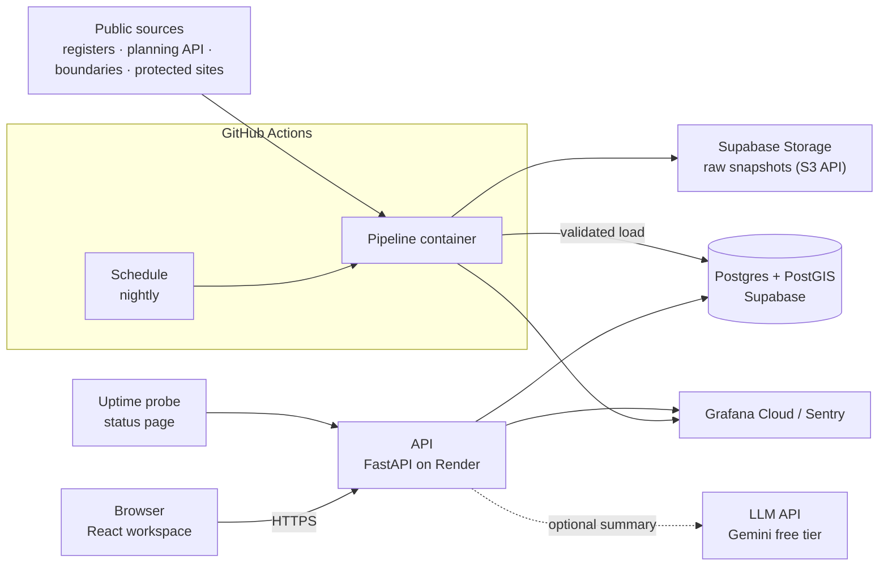
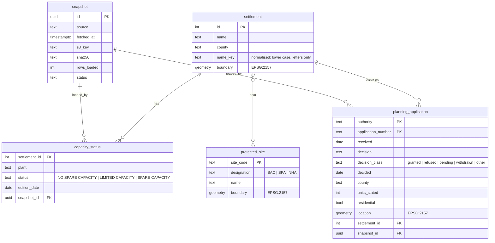

# DwellWise system design

Status: **draft for review** · Owner: Neel Sawant · Last updated: 8 November 2026

## 1. Problem

Someone planning a small housing scheme in Ireland (a self-builder, a small
developer, an architect's client) walks into their first meeting with the
planning authority without knowing what the public record already says about
the town: whether the wastewater plant has spare capacity, what was granted or
refused nearby, which protected sites are close, and which nearby towns could
take the homes instead.

That evidence is public but scattered across registers, map services and PDFs.
DwellWise gathers it into one **pre-planning brief** the user can edit, check
and print.

## 2. Goals and non-goals (v1)

**Goals**

- A brief for a chosen settlement and proposal size, built from public data.
- A national view of planning activity: how many applications were granted,
  refused or are still pending, across Ireland and per county, refreshed nightly.
- Every fact traceable to its source and the date that source was captured.
- Runs at **$0/month** on free tiers, with a cost alarm proving it.
- Operated like a production service: infrastructure as code, scanned
  delivery, monitoring with service-level objectives, runbooks.

**Non-goals**

- Planning advice or a likelihood of permission. The brief describes the
  town, never the user's site, and says so.
- Flood risk. The national flood maps are licensed CC-BY-NC-ND; no flood
  data is fetched or shown without written permission from the OPW.
- Applicant names or addresses. They are never fetched.
- User accounts in v1 (drafts stay in the browser; accounts are a later
  milestone).

## 3. Requirements

### Functional

| ID | The user can… |
|---|---|
| F1 | search for a settlement by name and county |
| F2 | enter a proposal: number of homes, houses or apartments |
| F3 | see wastewater capacity status for the settlement, in the register's own words, with the register edition date |
| F4 | see recent residential planning applications in the settlement and their decisions |
| F5 | see protected sites (SAC, SPA, NHA) within 1 km and 5 km |
| F6 | see nearby settlements with spare capacity, by distance |
| F7 | read an optional plain-English summary written over those facts |
| F8 | edit the brief, keep it in the browser, and print or export it |
| F9 | see planning activity for Ireland and each county: applications granted, refused and pending, by month, with the date the data was captured |

### Non-functional

| Area | Target |
|---|---|
| Availability | 99.0% of external health probes succeed per month (see §9 on free-tier cold starts) |
| Latency | Brief API p95 under 800 ms when warm |
| Freshness | Every source refreshed by a successful nightly run at least once in the last 48 hours |
| Correctness | Facts come from SQL and code, never from the AI step; the AI may only rephrase facts it is given |
| Cost | $0.00/month expected, alarm at $1 |
| Security | No long-lived cloud keys; least-privilege roles; every pull request scanned |

## 4. Architecture

| Component | Responsibility | Runs on |
|---|---|---|
| Web (`app/web`) | The workspace: search, proposal, brief, edit, print | Static files served by the API container |
| API (`app/api`) | Read-only queries that assemble a brief; optional summary; health and metrics | Render free web service (Docker) |
| Database | Settlements, capacity, applications, protected sites, snapshot log; PostGIS for spatial joins | Supabase free (500 MB) |
| Pipeline (`pipeline/`) | Fetch each source, store the raw file, validate, transform, load | Scheduled GitHub Actions job running the pipeline container, nightly |
| Raw store | Dated, immutable copies of every fetched file | Supabase Storage bucket through its S3-compatible API |
| Infrastructure (`terraform/`) | Terraform for Render, Supabase and GitHub settings, applied by CI; the AWS modules are kept, to be tested against the Floci emulator, never deployed | GitHub Actions |

**Why this split.** The API only reads, so it can scale and fail
independently of ingestion. The pipeline is the only writer, so every change
to the data is logged against a run and can be replayed from the raw store.

## 5. Data model

Rules carried over from the problem domain:

- **Name matching.** Registers and boundary data spell some towns differently
  and some names repeat across counties. Joins use a normalised name *and* the
  county; a settlement served by several plants takes the worst status.
- **Capacity wording.** "No spare capacity" means a Confirmation of
  Feasibility from Uisce Éireann and possibly an upgrade: time and cost, not
  a refusal. The UI uses the register's words and never colours or phrases it
  as a block.
- **Residential is not housing.** Many residential applications create no
  dwelling (extensions, retention). The brief says "residential planning
  applications" unless it filters to new dwellings.
- **Planning activity counts applications, not projects.** One scheme can be
  filed, withdrawn and filed again. The dashboard says "applications" and shows
  whether it counts all applications or residential ones only.
- **Decision classes.** Councils word decisions differently ("Conditional",
  "Grant Permission", "Refuse"). The pipeline maps each raw decision to a class
  through one tested table; anything unmapped is counted as "other" and raised as
  a validation warning, never guessed. The raw wording is kept.
- **Planning activity is not construction.** A grant is not a start on site.
  Construction starts need commencement notices, which are a separate source
  with their own licence check (open question below).
- **Coordinates** are stored in Irish Transverse Mercator (EPSG:2157) and
  reprojected only for display.

## 6. Pipeline

One pipeline run per source, scheduled nightly on GitHub Actions, each step idempotent and
keyed by a run id.

1. **Fetch** the source and write the untouched file to
   `raw/<source>/<YYYY-MM-DD>/<run_id>/` in the raw store with its SHA-256.
2. **Validate** before touching the database: expected columns present, no
   applicant name or address fields, row count within ±20% of the last good
   run (configurable per source), geometries valid.
3. **Transform** into the table shapes above.
4. **Load** into staging tables, then swap into the live tables in one
   transaction. A failed run leaves yesterday's data in place.
5. **Record** a `snapshot` row and emit metrics: rows loaded, duration,
   outcome, data age.

A failed run fails the workflow (GitHub emails the owner) and raises a Grafana Cloud alert. A run can be replayed from any
stored raw file, which makes backfills and bug fixes cheap.

**Sources (v1)**

| Source | What | Licence |
|---|---|---|
| Uisce Éireann wastewater capacity registers | Plant status per settlement | No licence stated; quoted with attribution and edition date |
| National Planning Applications (Department of Housing, ArcGIS REST) | Applications and decisions | CC BY 4.0 |
| Tailte Éireann settlement boundaries | Settlement polygons | CC BY 4.0, attribution "© Tailte Éireann" |
| NPWS protected sites | SAC, SPA and NHA boundaries | CC BY 4.0 |

## 7. API

Versioned under `/v1`, JSON only, one error shape `{"error": {"code", "message"}}`.

| Method and path | Purpose |
|---|---|
| `GET /health` | Process is up (liveness) |
| `GET /ready` | Database reachable and data younger than 48 h (readiness) |
| `GET /metrics` | Prometheus metrics: request counts and latency by route, data age |
| `GET /v1/settlements?q=` | Search settlements |
| `GET /v1/stats/applications?county=&residential=&from=&to=` | Planning activity: counts by decision class, per county and per month, with the snapshot's capture date. No county means all of Ireland |
| `GET /v1/settlements/{id}/brief?units=&type=` | Assemble the brief: capacity, applications, protected sites, alternatives, each with source and capture date |
| `POST /v1/settlements/{id}/brief/summary` | Optional AI summary over the brief's facts; rate-limited and cached |

Inside the API: routers (HTTP only) → services (brief assembly, rules above)
→ repositories (SQL). The OpenAPI schema is exported in CI and the web client
is generated from it, so the two cannot drift.

## 8. AI summary

- Input is the brief's facts as JSON with ids; output must cite those ids.
  A summary that cites an unknown id or a number not in the facts is
  rejected and the template summary is shown instead.
- Provider-agnostic (any OpenAI-compatible API); Gemini's free tier by
  default.
- Cached by a hash of the facts, so repeat views cost nothing.
- If the quota is exhausted or the call fails, the brief is complete without
  it. The AI is never on the critical path.

## 9. Reliability

| SLI | SLO | Measured by |
|---|---|---|
| Availability | 99.0% of probes succeed, monthly | External uptime probe every 5 minutes |
| Latency | p95 under 800 ms for `/v1/…/brief` and `/v1/stats/…`, warm | API metrics |
| Freshness | Data age under 48 h | `/ready` and pipeline metrics |
| Pipeline success | 95% of nightly runs succeed per 30 days | Snapshot log |

**Free-tier trade-off, stated up front.** Render's free service sleeps after
15 minutes idle and takes tens of seconds to wake. The availability probe
keeps it warm during the day and the SLO is set at 99.0%, not 99.9%. The
error budget and any breach are written up honestly rather than hidden.

Each alert has a runbook in `docs/runbooks/`: API down, data stale, pipeline
failed, database near its 500 MB limit, cost alarm.

## 10. Security

| Threat | Control |
|---|---|
| Leaked cloud credentials | None exist: CI uses OIDC and short-lived roles |
| CI compromise changing infrastructure | Plan role is read-only; apply needs the approved `production` environment; apply role limited to `dwellwise-*` and to roles under a permissions boundary it cannot change |
| Vulnerable dependencies or images | Dependabot, Trivy on code and image, SBOM on every release |
| Tampered build artefacts | Container images signed (keyless) and verified before deploy |
| Abuse of the AI endpoint | Per-IP and daily limits; cached responses; works without it |
| Secrets in git | gitleaks on full history; push protection on |
| Personal data | Applicant fields excluded at fetch and asserted absent at validation |

## 11. Environments and delivery

- **Pull request:** lint, test, type-check, Terraform plan, security scans, and
  the AWS modules applied to a throwaway Floci emulator.
- **Merge to main:** build and sign the image, Terraform apply (Render,
  Supabase, GitHub) after approval, deploy to Render.
- **Nightly:** a scheduled workflow runs the pipeline container; database and
  Storage credentials are GitHub Actions secrets.
- **Staging and production:** two Supabase projects (the free tier allows
  two); staging receives every merge, production on release.

## 12. Cost

| Service | Use | Monthly |
|---|---|---|
| Render | API container | $0 (free web service) |
| Supabase | Postgres + PostGIS, 500 MB | $0 (free) |
| GitHub Actions schedule, Supabase Storage | Nightly pipeline and raw files (1 GB free) | $0 |
| Grafana Cloud, Sentry, uptime probe | Observability | $0 (free tiers) |
| Gemini API | Optional summaries | $0 (free tier) |
| GitHub Actions | CI/CD on a public repo | $0 |

## 13. Decisions

| Decision | Chosen | Instead of | Because |
|---|---|---|---|
| Brief engine | Deterministic facts + optional AI summary | AI agent choosing tools | Testable, reliable on free quotas, monitorable |
| Cloud account | None: GitHub, Render, Supabase, Grafana Cloud | AWS free plan | No account that can bill; AWS is kept for another project. The AWS Terraform will be tested against the Floci emulator instead |
| Pipeline runtime | Scheduled GitHub Actions | Lambda + EventBridge Scheduler | No cloud account needed; free on a public repo; runs replayable from the raw store |
| App hosting | Render free | AWS App Runner or ECS | No free tier on those; Render is free with Docker |
| Database | Supabase (Postgres + PostGIS) | Amazon RDS | Free without expiry; PostGIS included |
| State locking (AWS modules) | S3-native lock file | DynamoDB table | One less resource; Terraform 1.10+ |
| Encryption at rest | SSE-S3 | Customer-managed KMS key | A KMS key costs ~$1/month; recorded as a reasoned scanner suppression |

## 14. Milestones

1. **Foundation** (done): keyless CI, scanning, AWS modules (written, not deployed;
   to be tested against the Floci emulator in CI).
2. **Delivery** (done): plan on pull request, apply on approval, drift check.
   Moves to the Render, Supabase and GitHub providers.
3. **Data:** pipeline core with counties and settlements (done); nightly run on
   GitHub Actions with raw copies in Supabase Storage; capacity registers,
   planning applications and protected sites; tests on fixtures; replay from the
   raw store.
4. **API** (first slice done): `/v1` endpoints, health, readiness, metrics; tests against a
   PostGIS container in CI.
5. **Web** (first slice done): hierarchical web app on the `/v1` API. The
   Ireland page becomes the national planning dashboard (F9) once planning
   applications load; each county page shows its own figures.
6. **Operate:** uptime probe and status page, dashboards (service health and the
   same planning counts as metrics), error tracking,
   SLOs, alerts, runbooks.
7. **Supply chain:** SBOM, signed images, OpenSSF Scorecard.
8. **Kubernetes:** Helm chart deployed to a throwaway cluster in CI.

## 15. Open questions

- Which register editions to keep: latest only, or history to show status
  changes over time?
- Whether staging needs its own Storage bucket or can share one with a prefix.
- How far back to load planning applications (all time or the last 10 years)
  given the 500 MB database limit. The dashboard's trend length follows from it.
- Whether commencement notices (Building Control Management System) can be
  used, under what licence, to show construction starts beside planning
  decisions. Not in v1 until checked.
