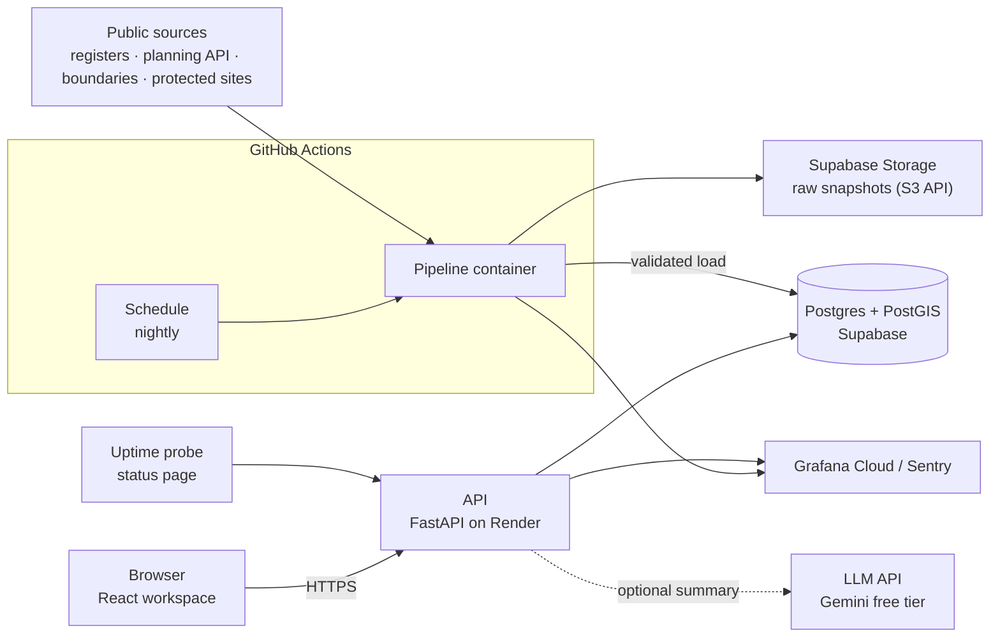
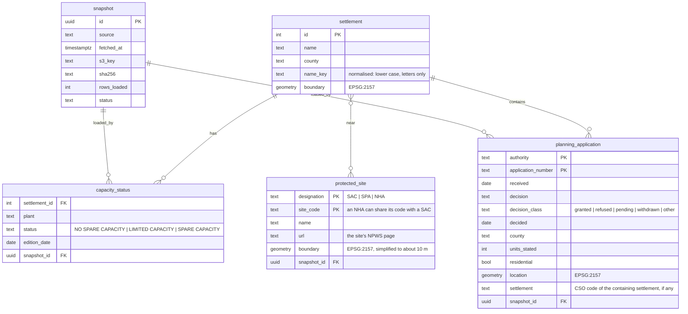

# DwellWise system design

Status: **draft for review** · Owner: Neel Sawant · Last updated: 8 November 2026

## 1. Problem

Someone planning a small housing scheme in Ireland (a self-builder, a small
developer, an architect's client) walks into their first meeting with the
planning authority without knowing what the public record already says about
the town: whether the wastewater plant has spare capacity, what was granted or
refused nearby, which protected sites are close, and which nearby towns could
take the homes instead.

That evidence is public but scattered across registers, map services and PDFs.
DwellWise gathers it into one **pre-planning brief** the user can edit, check
and print.

## 2. Goals and non-goals (v1)

**Goals**

- A brief for a chosen settlement and proposal size, built from public data.
- A national view of planning activity: how many applications were granted,
  refused or are still pending, across Ireland and per county, refreshed nightly.
- Every fact traceable to its source and the date that source was captured.
- Runs at **$0/month** on free tiers, with no account that can bill.
- Operated like a production service: infrastructure as code, scanned
  delivery, monitoring with service-level objectives, runbooks.

**Non-goals**

- Planning advice or a likelihood of permission. The brief describes the
  town, never the user's site, and says so.
- Flood risk. The national flood maps are licensed CC-BY-NC-ND; no flood
  data is fetched or shown without written permission from the OPW.
- Applicant names or addresses. They are never fetched.
- User accounts in v1 (drafts stay in the browser; accounts are a later
  milestone).

## 3. Requirements

### Functional

| ID | The user can… |
|---|---|
| F1 | search for a settlement by name and county |
| F2 | enter a proposal: number of homes, houses or apartments |
| F3 | see wastewater capacity status for the settlement, in the register's own words, with the register edition date. **For now a link** to the county's Uisce Éireann register, since its terms do not allow republishing (§6) |
| F4 | see recent residential planning applications in the settlement and their decisions |
| F5 | see protected sites (SAC, SPA, NHA) within 1 km and 5 km |
| F6 | see nearby settlements with spare capacity, by distance. **Deferred:** it needs the capacity register's data (F3) |
| F7 | read an optional plain-English summary written over those facts |
| F8 | edit the brief, keep it in the browser, and print or export it |
| F9 | see planning activity for Ireland and each county: applications granted, refused and pending, by month, with the date the data was captured |

### Non-functional

| Area | Target |
|---|---|
| Availability | 99.0% of external health probes succeed per month (see §9 on free-tier cold starts) |
| Latency | Brief API p95 under 800 ms when warm |
| Freshness | Every source refreshed by a successful nightly run at least once in the last 48 hours |
| Correctness | Facts come from SQL and code, never from the AI step; the AI may only rephrase facts it is given |
| Cost | $0.00/month: free tiers only, no account that can bill |
| Security | No long-lived cloud keys; least-privilege roles; every pull request scanned |

## 4. Architecture

| Component | Responsibility | Runs on |
|---|---|---|
| Web (`app/web`) | The workspace: search, proposal, brief, edit, print | Static files served by the API container |
| API (`app/api`) | Read-only queries that assemble a brief; optional summary; health and metrics | Render free web service (Docker) |
| Database | Settlements, capacity, applications, protected sites, snapshot log; PostGIS for spatial joins | Supabase free (500 MB) |
| Pipeline (`pipeline/`) | Fetch each source, store the raw file, validate, transform, load | Scheduled GitHub Actions job running the pipeline container, nightly |
| Raw store | Dated, immutable copies of every fetched file | Supabase Storage bucket through its S3-compatible API |
| Infrastructure (`terraform/`) | Terraform for Render, Supabase and GitHub settings, applied by CI; the AWS modules are kept and applied to the Floci emulator on every pull request, never deployed | GitHub Actions |

**Why this split.** The API only reads, so it can scale and fail
independently of ingestion. The pipeline is the only writer, so every change
to the data is logged against a run and can be replayed from the raw store.

## 5. Data model

Rules carried over from the problem domain:

- **Name matching.** Registers and boundary data spell some towns differently
  and some names repeat across counties. Joins use a normalised name *and* the
  county; a settlement served by several plants takes the worst status.
- **Capacity wording.** "No spare capacity" means a Confirmation of
  Feasibility from Uisce Éireann and possibly an upgrade: time and cost, not
  a refusal. The UI uses the register's words and never colours or phrases it
  as a block.
- **Residential is not housing.** Many residential applications create no
  dwelling (extensions, retention). The brief says "residential planning
  applications" unless it filters to new dwellings. In the data, `residential`
  is true only when an application states dwellings: a unit count above zero
  or a one-off house.
- **County comes from the planning authority.** The 31 authorities map onto the
  26 counties (the four Dublin councils to Dublin, city and county councils
  together). An authority the table does not know rejects the run.
- **Planning activity counts applications, not projects.** One scheme can be
  filed, withdrawn and filed again. The dashboard says "applications" and shows
  whether it counts all applications or residential ones only.
- **Decision classes.** Councils word decisions differently ("Conditional",
  "Grant Permission", "Refuse"). The pipeline maps each raw decision to a class
  through one tested table; anything unmapped is counted as "other" and raised as
  a validation warning, never guessed. The raw wording is kept. A blank decision
  falls back to the application's status (withdrawn, invalid), otherwise it is
  pending. Against the data from 2020, the table recognises all but 0.1% of rows.
- **Planning activity is not construction.** A grant is not a start on site.
  Construction starts need commencement notices, which are a separate source
  with their own licence check (open question below).
- **Protected sites are near the town, not the site.** The brief lists SACs,
  SPAs and NHAs whose boundary lies within 5 km of the settlement boundary, with
  the shortest distance between the two boundaries, banded "touches or overlaps
  the town", "within 1 km" and "within 5 km". It describes the town's
  surroundings; it is not an Appropriate Assessment screening and says so.
  Proposed NHAs are not in v1. Boundaries are fetched simplified to about 10 m,
  which cuts the SPA download from 47 MB to 4 MB and is far finer than the bands.
  A site published as several features is merged into one.
- **Coordinates** are stored in Irish Transverse Mercator (EPSG:2157) and
  reprojected only for display.

## 6. Pipeline

One pipeline run per source, scheduled nightly on GitHub Actions, each step idempotent and
keyed by a run id.

1. **Fetch** the source and write the untouched file, gzipped, to
   `raw/<source>/<YYYY-MM-DD>/<run_id>.geojson.gz` in the raw store, with the
   SHA-256 of the uncompressed file. Copies older than 7 days are pruned after
   each run, except the newest copy of each source (planning is about 10 MB a
   night compressed, so the 1 GB free Storage holds the window easily).
2. **Validate** before touching the database: expected columns present, no
   applicant name or address fields, row count within ±20% of the last good
   run (configurable per source), geometries valid.
3. **Transform** into the table shapes above.
4. **Load** into staging tables, then swap into the live tables in one
   transaction. A failed run leaves yesterday's data in place.
5. **Record** a `snapshot` row and emit metrics: rows loaded, duration,
   outcome, data age.

A failed run fails the workflow (GitHub emails the owner) and, once monitoring
lands, raises a Grafana Cloud alert. A run can be replayed from any stored raw
file, which makes backfills and bug fixes cheap. What to do when it fails:
[`docs/runbooks/pipeline-failed.md`](runbooks/pipeline-failed.md).

**Sources (v1)**

| Source | What | Licence |
|---|---|---|
| Uisce Éireann wastewater capacity registers | Plant status per settlement | **Not reusable.** Not among Uisce Éireann's CC BY 4.0 open datasets, and the water.ie terms forbid republishing without written consent (checked 21 November 2026). The brief links to the county register instead of loading it |
| National Planning Applications (Department of Housing, ArcGIS REST) | Applications and decisions | CC BY 4.0 |
| Tailte Éireann settlement boundaries | Settlement polygons | CC BY 4.0, attribution "© Tailte Éireann" |
| NPWS designated areas (ArcGIS REST, the service named on npws.ie) | SAC, SPA and NHA boundaries, one source each | CC BY 4.0 |
| Building Commencement and Completion Data, National Building Control Office (one CSV, refreshed each morning) | Residential commencement notices since 2020, one row per notice (M9) | CC BY 4.0 |

**Commencement notices (M9).** The file is about 280 MB with one row per
building. The source streams it and keeps only residential notices received
since 2020, one feature per notice, with the fields in `dw.commencement`; the
raw copy is that projection (about 3 MB), not the whole file, because the rest
holds street names, Eircodes and project names that identify one-off homes. A
project name is kept only for notices of five homes or more, and the API lists
nothing smaller. Two councils are spelt differently from the planning dataset
and are mapped by name; an unknown council or an impossible start date rejects
the run. This is the source that is fresh to the previous night: the planning
dataset itself runs about ten days behind, and the dashboard says so.

## 7. API

Versioned under `/v1`, JSON only, one error shape `{"error": {"code", "message"}}`.

| Method and path | Purpose |
|---|---|
| `GET /health` | Process is up (liveness) |
| `GET /ready` | Database reachable and data younger than 48 h (readiness) |
| `GET /metrics` | Prometheus metrics: request counts and latency by route, data age |
| `GET /v1/settlements?q=` | Search settlements |
| `GET /v1/stats/applications?county=&residential=&from=&to=` | Planning activity: counts by decision class, per county and per month, with the snapshot's capture date. No county means all of Ireland |
| `GET /v1/settlements/{id}/brief?units=&type=` | Assemble the brief: capacity, applications, protected sites, alternatives, each with source and capture date. First slice live: planning precedents (residential applications in the boundary over five years: counts by decision class, the ten most recent, all applications for context); protected sites (SACs, SPAs and NHAs within 5 km of the boundary, nearest first); the other sections are listed as `pending`. `units` and `type` arrive with the capacity section |
| `POST /v1/settlements/{id}/brief/summary` | Optional AI summary over the brief's facts; rate-limited and cached |

Inside the API: routers (HTTP only) → services (brief assembly, rules above)
→ repositories (SQL). The OpenAPI schema is exported in CI and the web client
is generated from it, so the two cannot drift.

## 8. AI summary

- Input is the brief's facts as JSON with ids; output must cite those ids.
  A summary that cites an unknown id or a number not in the facts is
  rejected and the template summary is shown instead.
- Provider-agnostic (any OpenAI-compatible API); Groq's free tier by
  default (its prompts are not used for training), Gemini's or Cloudflare
  Workers AI's free tier as fallbacks. See §16 for the v2 assistant.
- Cached by a hash of the facts, so repeat views cost nothing.
- If the quota is exhausted or the call fails, the brief is complete without
  it. The AI is never on the critical path.

## 9. Reliability

| SLI | SLO | Measured by |
|---|---|---|
| Availability | 99.0% of `/health` checks pass, rolling 14 days | Grafana Synthetic Monitoring, every 2 minutes from two locations (Terraform) |
| Latency | p95 under 800 ms for `/v1/…/brief` and `/v1/stats/…`, warm | API metrics |
| Freshness | 99.0% of `/ready` checks pass, rolling 14 days (every source under 48 h) | The same probes every 10 minutes; `dwellwise_data_age_hours` |
| Pipeline success | 95% of nightly runs succeed per 30 days | Snapshot log |

The objectives, the error budget, the burn-rate alerts and the policy when the
budget runs out are in [`docs/slo.md`](slo.md); write-ups in
[`docs/incidents/`](incidents/).

**Free-tier trade-off, stated up front.** Render's free service sleeps after
15 minutes idle and takes tens of seconds to wake. The synthetic `/health` check
every 2 minutes keeps it awake (one service uses about 730 of the 750 free hours
a month). The SLO is 99.0%, not 99.9%, over 14 days because Grafana Cloud's free
tier keeps 14 days of metrics. The error budget and any breach are written up
honestly rather than hidden.

**Why not GitHub's cron.** Availability was first measured by `ops/probe.py` on
a scheduled workflow every 10 minutes. GitHub fired none of its scheduled runs
in the first five hours (write-up in `docs/incidents/`), so the SLI moved to
Grafana's probes, which run on a fixed schedule and alert if they stop
("Synthetic checks missing"). The GitHub probe stays as a backup.

**Incidents are GitHub issues.** When a check fails all its attempts, the GitHub probe (when it runs)
opens an issue labelled `incident` (one per check: API down, data stale,
dashboard API failing) linking its runbook, and closes it with the outage length
when the check passes again. The issue list is the public incident log. Latency
over a check's budget is reported as "slow" in the run summary, never as down.
**Grafana Cloud, as code.** Its hosted scraper reads `/metrics` every minute
(bearer token). `terraform/stacks/observability` defines the scrape job, a
service dashboard (requests, p95 latency against the SLO, server errors, data
age, and the SLO panels) and alerts emailed to the owner, among them the two
error-budget burn alerts and the probe heartbeat described in `docs/slo.md`: slow responses (p95 of `/v1` over
0.8 s for 10 minutes), server errors (over 5% for 10 minutes, `/ready` excluded
because its 503 means stale data), data stale (over 48 hours) and metrics
missing (nothing for 20 minutes). Each alert links its runbook.

Each alert has a runbook in `docs/runbooks/`: API down, data stale, pipeline
failed; database near its 500 MB limit and Storage near its 1 GB limit come with
the Grafana alerts.

**Errors to Sentry.** Unhandled API errors (the 500s) go to Sentry's free tier,
tagged with the deployed commit (`RENDER_GIT_COMMIT`), so each one arrives with
its stack trace and the release that introduced it. Metrics say how many fail;
Sentry says why. It is off unless `SENTRY_DSN` is set; tracing is off because
Grafana covers latency; and frame local variables are not sent, because they
hold request headers and the database URL (a test checks a bearer token never
reaches an event). The pipeline is not wired in: its failures are failed
workflow runs and stale-data alerts.

## 10. Security

| Threat | Control |
|---|---|
| Leaked cloud credentials | None exist: CI uses OIDC and short-lived roles |
| CI compromise changing infrastructure | Plan role is read-only; apply needs the approved `production` environment; apply role limited to `dwellwise-*` and to roles under a permissions boundary it cannot change |
| Vulnerable dependencies or images | Dependabot; Trivy on the IaC and on both images (HIGH or CRITICAL with a fix fails the build); an SPDX SBOM attested to every published image |
| Tampered build artefacts | Images pushed to GHCR by digest and signed keyless with cosign (GitHub OIDC, Sigstore). The nightly pipeline runs only the digest it has verified was signed by this repository's `images` workflow on `main`. Render still builds the app from source; moving it to the signed image is the next step |
| Abuse of the AI endpoint | Per-IP and daily limits; cached responses; works without it |
| Secrets in git | gitleaks on full history; push protection on |
| Personal data | Applicant fields excluded at fetch and asserted absent at validation |
| Third-party content on the page | The CSP allows one outside host, OpenFreeMap, for map tiles and fonts only (no scripts); map pop-ups set text, never HTML |
| Secrets in error reports | Sentry gets no frame local variables and no default personal data; a test sends a bearer token and asserts it is absent from the event |

## 11. Environments and delivery

- **Pull request:** lint, test, type-check, Terraform plan, security scans, and
  the AWS modules applied to a throwaway Floci emulator (a service container in
  the CI job). A CI-only `floci_override.tf` points the provider at it; the
  stacks themselves are unchanged. The job applies the bootstrap, then the data
  stack with S3-native state locking in the bootstrap bucket, requires a second
  plan with no changes, and asserts the bucket and role controls with the AWS CLI
  (`.github/floci/check.sh`). An emulator is not AWS: it proves the code applies,
  converges and sets what it says, not that real IAM would evaluate the
  policies the same way.
- **Merge to main:** `.github/workflows/images.yml` builds both images,
  scans them with Trivy, pushes them to GHCR, signs each digest with cosign
  (keyless) and attests its SBOM; on pull requests it builds and scans without
  pushing. Terraform apply (Render, Supabase, GitHub) after approval; Render
  deploys. OpenSSF Scorecard runs weekly and on merge (`scorecard.yml`) and
  publishes its result.
- **GitHub settings:** `terraform/stacks/github`, applied by
  `.github/workflows/github-settings.yml` (plan on pull request and weekly,
  apply on merge; state in the `terraform_github` schema). It owns the
  repository's description and features, Dependabot alerts and security
  updates, secret scanning with push protection, the `main` ruleset and the
  environments. The ruleset: changes reach `main` only by pull request, with
  the seven CI jobs that always run (lint and tests, scans, the Floci and kind jobs) as required checks (path-filtered workflows are
  not required: a check that never runs would block the merge), no force
  pushes, no deletion, nobody can bypass. No approving review is required,
  because GitHub does not let an author approve their own pull request.
  Credentials come from a GitHub App installed on this repository only; each
  run mints a one-hour token, read-only for plans, so no personal token exists.
- **Supabase settings:** `terraform/stacks/supabase`, applied by
  `.github/workflows/supabase-settings.yml` (same plan/apply/weekly pattern,
  state in `terraform_supabase`). It manages only `supabase_settings`, and of
  that only SSL enforcement (on). Turning it on showed that Terraform's pg state
  backend did not use TLS, so `ops/dburl.py` now adds `sslmode=require`.
  Disabling auth sign-ups (the app has no user accounts) needs the
  `project_admin_write` permission, which would let the CI token change any
  project setting; it was switched off once in the dashboard instead, a recorded
  exception to "no click-ops".
  The project resource is deliberately not managed: the provider resets the
  database password when the configured value differs from state, and an
  imported project has none, so adopting it could rotate the live password.
  Credentials: a scoped Supabase access token in the `supabase-settings`
  environment, limited to this one project, expiring after 90 days, read-only
  except for SSL enforcement (read-write), and with no access to SQL, backups,
  API key secrets, the JWT secret or signing keys. Supabase has
  no OIDC exchange, so it is a stored token, rotated when it expires. On 21 November 2026 the
  last legacy objects in `public` were dropped (six tables and a view left by the
  old app, readable with the anon key through the Data API; two held a copy of
  the capacity register, which may not be republished). `public` is now empty
  and the anon role has no access to `dw`.
- **Kubernetes:** `deploy/helm/dwellwise` packages the app image as a Helm
  chart, and a CI job installs it on every pull request into a throwaway kind
  cluster, in a namespace that enforces the Pod Security `restricted` profile.
  The chart runs non-root with a read-only root filesystem (an `emptyDir` for
  `/tmp`), drops all capabilities, uses the runtime-default seccomp profile,
  sets requests and limits, mounts no service-account token, and ships a
  NetworkPolicy (ingress on the app port; egress to DNS and Postgres only).
  Secrets come from an existing Secret the chart only references. Liveness and
  readiness both use `/health`, not `/ready`: a stale or unreachable data source
  should leave the site serving its last good data with the age shown, not take
  every pod out of the Service. `helm test` runs a smoke check with the app's own
  image (no extra image to trust). Production stays on Render; the cluster
  exists only for the length of the job.
- **Render:** stays on its Blueprint (`render.yaml`), which is Render's own
  configuration as code. The Terraform provider cannot update free-tier web
  services (render-oss/terraform-provider-render#80, open as of v1.9.1) and the
  API refuses to create them, so Terraform would fail on its first change.
- **Observability:** `.github/workflows/observability.yml` plans the Grafana
  stack on pull requests and applies it on merge. Its state sits in the
  project's Postgres (Terraform's `pg` backend, schema `terraform_observability`),
  so no state service or extra account is needed; tokens are secrets of the
  `observability` environment. The stack's `terraform` service account has the
  **Admin** role: with Editor, Grafana Cloud let it create a folder but refused
  to read it back (`folders:read`), which broke the first apply. Admin is what
  Grafana documents for provisioning; on a one-person stack the wider scope
  (it could also manage users) is an accepted trade-off. A narrower custom role
  is the upgrade path if the stack ever has more users.
- **Nightly:** `.github/workflows/pipeline.yml` builds the same pipeline image
  CI scans and runs it at 03:17 UTC: migrate, every source in order, prune.
  Database and Storage credentials are secrets of the `nightly` environment, so
  no other job can read them; values reach the container through an env file,
  never a command line. It can also be started by hand for one source.
- **Staging and production:** two Supabase projects (the free tier allows
  two); staging receives every merge, production on release.

## 12. Cost

| Service | Use | Monthly |
|---|---|---|
| Render | API container | $0 (free web service) |
| Supabase | Postgres + PostGIS, 500 MB | $0 (free) |
| GitHub Actions schedule, Supabase Storage | Nightly pipeline and raw files (1 GB free) | $0 |
| Grafana Cloud, Sentry, uptime probe | Observability | $0 (free tiers) |
| Gemini API | Optional summaries | $0 (free tier) |
| GitHub Actions | CI/CD on a public repo | $0 |

## 13. Decisions

| Decision | Chosen | Instead of | Because |
|---|---|---|---|
| Brief engine | Deterministic facts + optional AI summary | AI agent choosing tools | Testable, reliable on free quotas, monitorable |
| Cloud account | None: GitHub, Render, Supabase, Grafana Cloud | AWS free plan | No account that can bill; AWS is kept for another project. The AWS Terraform is applied to the Floci emulator in CI instead |
| Pipeline runtime | Scheduled GitHub Actions | Lambda + EventBridge Scheduler | No cloud account needed; free on a public repo; runs replayable from the raw store |
| CI credentials for GitHub settings | GitHub App, one-hour installation token per run (read-only for plans) | Fine-grained personal access token | No long-lived personal token; scoped to one repository; least privilege per run |
| Render configuration | Blueprint (`render.yaml`) | Terraform `render-oss/render` | The provider cannot update free-tier services (issue #80); a Blueprint is Render's native config as code |
| Terraform state for Grafana, GitHub and Supabase | Postgres `pg` backend in Supabase | HCP Terraform, S3 | Free, already there, has locking; no extra account. Kept in its own schema |
| App hosting | Render free | AWS App Runner or ECS | No free tier on those; Render is free with Docker |
| Database | Supabase (Postgres + PostGIS) | Amazon RDS | Free without expiry; PostGIS included |
| State locking (AWS modules) | S3-native lock file | DynamoDB table | One less resource; Terraform 1.10+ |
| Encryption at rest | SSE-S3 | Customer-managed KMS key | A KMS key costs ~$1/month; recorded as a reasoned scanner suppression |
| v2 assistant | AI agent with DwellWise's own API as its only tools, numbers checked against tool output | Model answering from its own knowledge | Facts stay in code (rule 6); hallucinated numbers are caught by a test, not by a user. The brief itself stays deterministic |
| Valuation | Area-level price indices and town aggregates | Per-site valuation | No free per-site data; sale addresses are personal data; area evidence fits a town-level brief |

## 14. Milestones

1. **Foundation** (done): keyless CI, scanning, AWS modules (written, not deployed;
   applied to the Floci emulator on every pull request).
2. **Delivery** (done): plan on pull request, apply on approval, drift check.
   Moves to the Render, Supabase and GitHub providers.
3. **Data:** pipeline core with counties and settlements (done); nightly run on
   GitHub Actions with raw copies in Supabase Storage; capacity registers,
   planning applications and protected sites; tests on fixtures; replay from the
   raw store.
4. **API** (first slice done): `/v1` endpoints, health, readiness, metrics; tests against a
   PostGIS container in CI.
5. **Web** (first slice done): hierarchical web app on the `/v1` API. The
   Ireland page becomes the national planning dashboard (F9) once planning
   applications load; each county page shows its own figures.
6. **Operate:** uptime probe with incidents as issues and runbooks (done);
   Grafana Cloud dashboards (service health and the same planning counts as
   metrics) and alerts, defined in Terraform; error tracking.
7. **Supply chain:** SBOM, signed images, OpenSSF Scorecard.
8. **Kubernetes:** Helm chart deployed to a throwaway kind cluster in CI on every
   pull request, under the Pod Security `restricted` profile.

v2, detailed in §16:

9. **Live developments dashboard.**
10. **Prices** (area level).
11. **Cost and feasibility calculator.**
12. **AI platform layer.**
13. **Scheme assistant.**
14. **UI redesign.**

## 15. Open questions

- Which register editions to keep: latest only, or history to show status
  changes over time?
- Whether staging needs its own Storage bucket or can share one with a prefix.
- How far back to load planning applications. v1 loads applications received
  from 1 January 2020 (about 264,000 of 513,000), to stay well inside the 500 MB
  database; widen it once the table's size is measured.
- ~~Whether commencement notices can be used.~~ Settled 24 Nov 2026: the
  National Building Control Office publishes them nationally under CC BY 4.0,
  refreshed daily (the Department's yearly files are CC BY-SA and stop in 2021).
- The Property Price Register's reuse terms. The PSRA encourages reuse of its
  information, but no licence text was found for the register itself (checked
  24 Nov 2026). M10 uses it only once the terms are confirmed, aggregated, and
  without addresses.
- Each free AI tier's current limits and data terms; published figures
  disagree. Confirm in the provider's own documentation before M12.

## 16. v2: live developments, prices, costs and an AI assistant

Agreed 24 November 2026. The same constraints hold: $0 a month, open licences
only, facts from code, one milestone per pull request. The AI proposes
evidence; it never predicts a planning decision or values a site.

**M9. Live developments dashboard.** The Ireland, county and settlement pages
show recent applications (newest first), what is new since the last nightly
run, and a map (MapLibre with free vector tiles whose terms allow it). Every view
states when the data was captured and the newest application date in the
source, so "as recent as last night" is shown, not assumed. Commencement
notices add construction starts if their licence allows; otherwise the
dashboard shows applications and decisions only. Data age stays under the
existing freshness SLO.

Built in two parts. M9a (PR #50): construction starts from commencement notices
on the Ireland, county and town pages, and the planning panel's note on how far
its source runs. M9b: a map on the Ireland and county pages of schemes of five
homes or more, started (filled, survey blue) or applied for (ringed, grey), last
12 months, from `GET /v1/map/developments` (GeoJSON, coordinates rounded to
about 10 m). Nothing smaller is placed on a map. MapLibre GL (BSD-3) is loaded
only when a map is shown; tiles, fonts and sprites come from OpenFreeMap (free,
no key, no cookies), so the CSP allows `https://tiles.openfreemap.org` for
images and connections and `worker-src 'self'` for MapLibre's bundled worker.
Pop-ups are built with `textContent`, never HTML. Responses are gzipped.
Councils that state a number of units on under 10% of their applications in
the period (Cork County and Dún Laoghaire-Rathdown at 0%, South Dublin 4%,
Dublin City 6%, measured 25 Nov 2026) are named under the map, with their
share: their applications cannot be sized, so an empty area there is a gap in
the source, not an absence of schemes.

**M10. Prices, area level.** The CSO Residential Property Price Index (PxStat
API, CC BY 4.0; county and Eircode routing area) as a trend per county and per
settlement's routing area. Property Price Register sales, aggregated per town
(count and median by year, no addresses, small groups suppressed), only once
its terms are confirmed. A new brief section with the source and date of each
figure. Not a valuation of any site.

**M11. Cost and feasibility calculator.** Deterministic code: build cost per
square metre, the council's development contribution charges (from its
published scheme, cited with its date), professional fees, finance and a
contingency. Every input is the user's or a cited published rate; the result
shows its working. Stays in the browser like drafts.

**M12. AI platform layer.** The engineering core of v2:

- One thin client for OpenAI-compatible APIs; Groq free tier first, Gemini or
  Cloudflare Workers AI as fallbacks. The key is a secret on Render; nothing
  runs without it.
- Tools are DwellWise's own API only: search settlements, read a brief,
  national and county statistics, price index, cost calculator. No web access,
  no free-form SQL.
- Every number in an answer must appear in a tool result from the same run;
  an answer that fails the check is rejected, not shown. Text from public
  sources is treated as data, never as instructions.
- An evaluation set of questions runs in CI against recorded tool results, so a
  prompt or model change that breaks grounding fails the build.
- Per-IP and daily limits, responses cached by input, a kill switch, and the
  site fully usable with the AI off.
- Token use, latency, refusals and failures as Prometheus metrics on the
  Grafana dashboard, with an alert when the daily free quota is close.

**M13. Scheme assistant.** The user describes a scheme ("eight homes in north
Cork, near a town with spare treatment capacity"). The assistant asks what is
missing, searches and compares towns through the tools, and returns a ranked
shortlist with the trade-offs, links to each brief and a citation for every
figure. It describes towns and evidence; it does not say whether permission
would be granted.

**M14. UI redesign.** After M9 to M13, so the design serves the finished
features. Rule 10 (minimal, hierarchical, one accent) is revisited in that pull
request.

**Constraint screening** (with M10 or M13, as licences allow): radon (EPA),
landslide susceptibility (GSI), recorded monuments (National Monuments
Service), beside the protected sites already shown. Flood data stays out.
